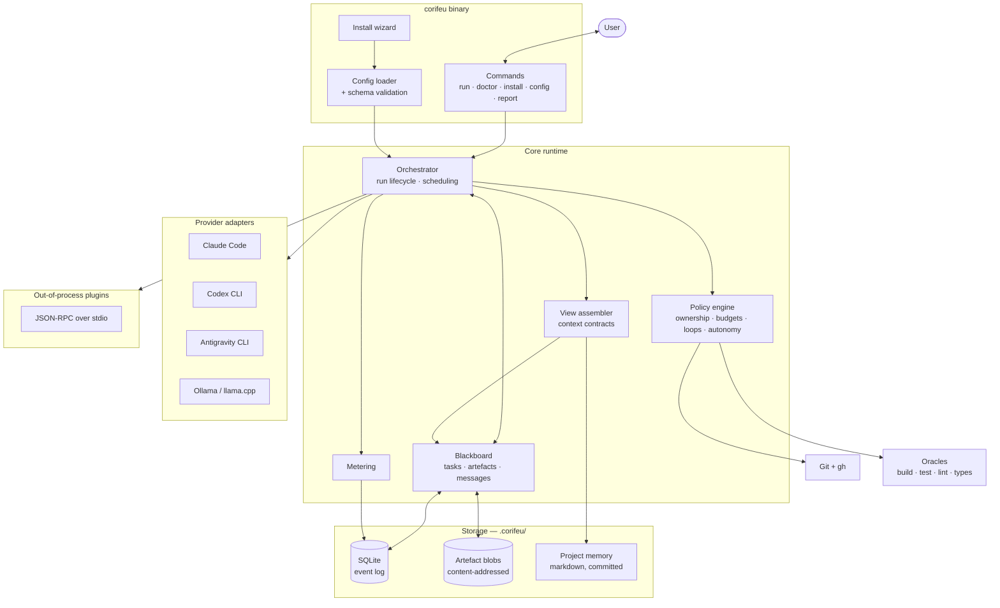
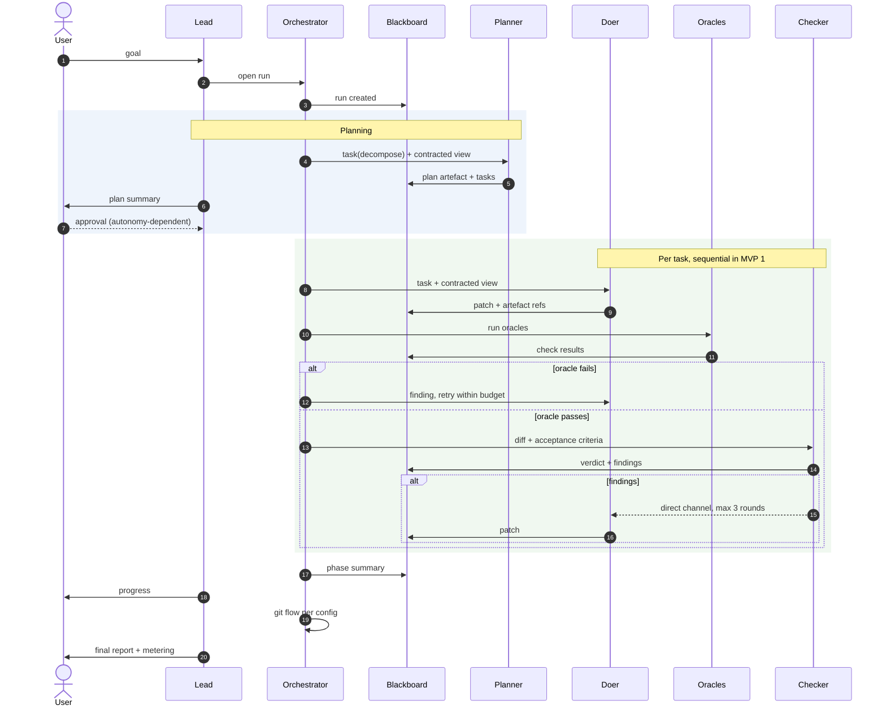
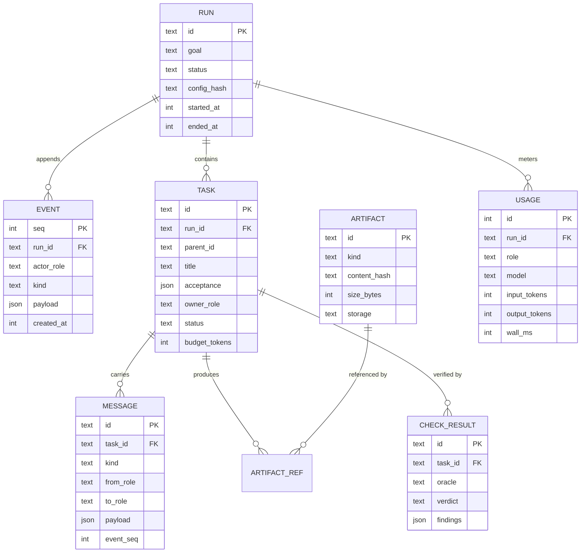
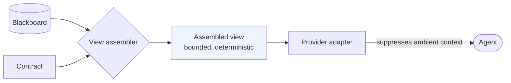
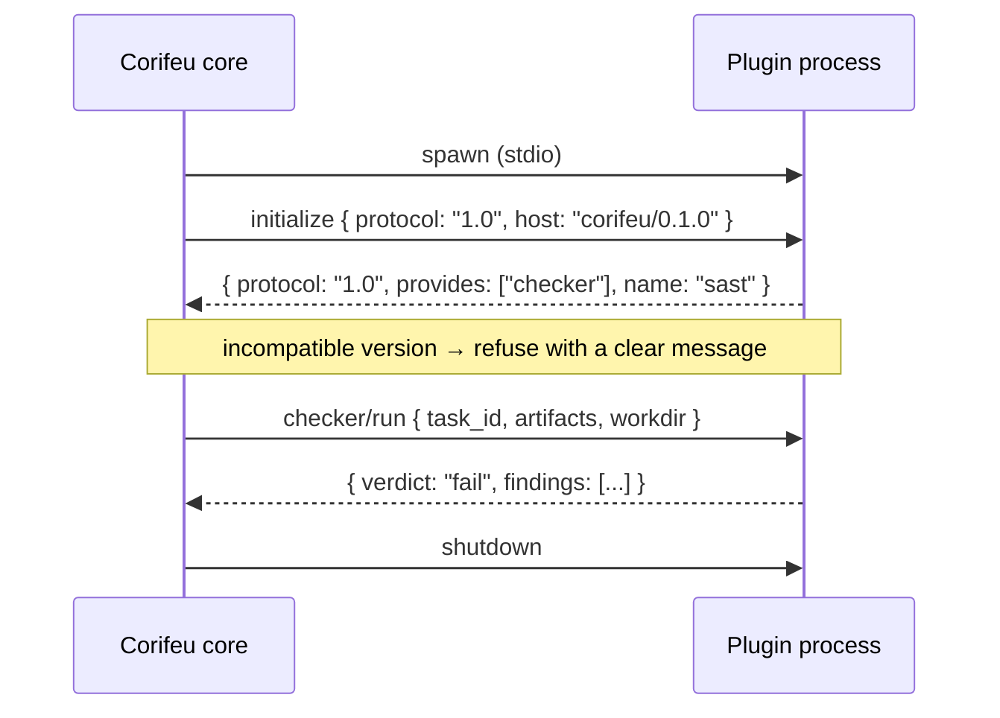
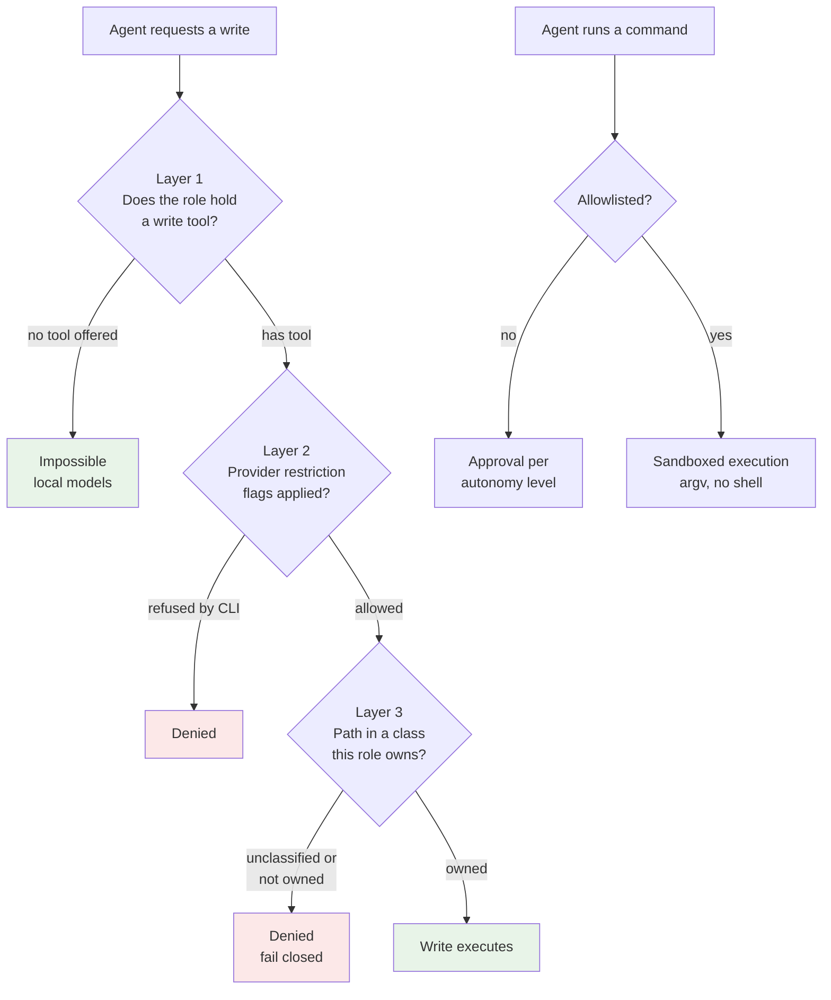
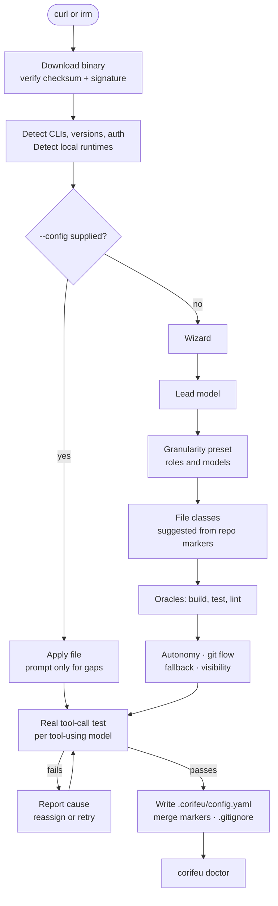
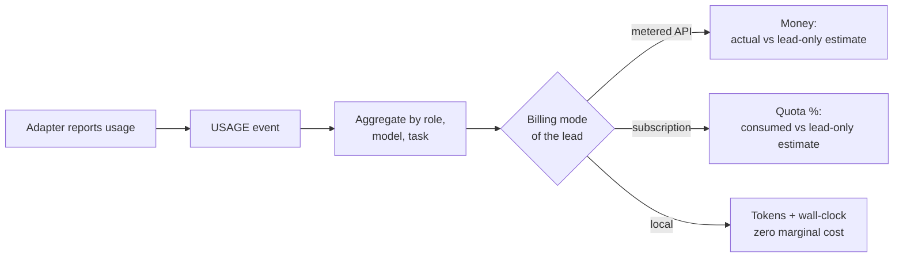

# Target architecture

How Corifeu is built, and why each part is shaped the way it is. Every decision referenced
here has an ADR in [adr/](adr/); this document shows how they fit together.

Items that could not be verified are marked **UNVERIFIED**.

## Principles

Five constraints generate most of the design. Everything else follows from them.

1. **One agent faces the user.** The lead is the only agent with a channel to the human
   ([ADR-0010](adr/0010-role-categories.md)).
2. **No agent holds the whole run.** Each receives an assembled view, never the board
   ([ADR-0014](adr/0014-context-contracts-per-role.md)). This is where the token saving
   comes from.
3. **Nothing exists until it is on the board.** Prose assertions are not state
   ([ADR-0013](adr/0013-blackboard-as-source-of-truth.md)).
4. **Oracles outrank opinions.** A failing test beats any agent's argument
   ([ADR-0019](adr/0019-tie-breaking-and-oracle-precedence.md)).
5. **Capability, not instruction.** An agent that must not do something is never given the
   means ([ADR-0036](adr/0036-runtime-enforced-tool-restriction.md)).

## Component map



The orchestrator never talks to a model directly — only through an adapter. The view
assembler is the only component that may read broadly from the board, and it is the only
one that writes into an agent's context. Those two facts are what make context contracts
enforceable rather than aspirational.

## Run lifecycle



Two properties are worth naming. The lead appears only at the top and the bottom and at
escalations — it is deliberately absent from the inner loop, which is the entire economic
argument. And the coder↔checker exchange is a direct channel
([ADR-0015](adr/0015-contracted-direct-channels.md)) that still records every message on
the board, so "direct" never means "unobserved".

## Blackboard data model



`EVENT` is the authority. Every other table is a **projection** that the runtime rebuilds by
replaying events, which is what makes replay, resume and audit a single mechanism rather
than three ([ADR-0021](adr/0021-sqlite-with-event-log.md)).

Four columns exist solely so that parallel execution later needs no redesign
([ADR-0020](adr/0020-sequential-execution-in-mvp1.md)): `TASK.owner_role`, `TASK.status`,
`ARTIFACT.content_hash` and the monotonic `EVENT.seq`.

`ARTIFACT.storage` is `inline` for small payloads and `blob` for content-addressed files on
disk. Because blobs are addressed by hash, a file re-read twenty times is stored once —
which is most of why run sizes stay modest ([ADR-0022](adr/0022-run-retention-policy.md)).

## Message types

Every agent output is a typed, schema-validated message
([ADR-0016](adr/0016-typed-messages-with-schemas.md)).

| Kind | From | To | Closes a task? |
|---|---|---|---|
| `task` | lead, planner | any | no |
| `question` | any | declared peer | no |
| `answer` | any | declared peer | no |
| `patch` | doer | board | only with required artefacts |
| `finding` | checker | doer | no |
| `verdict` | checker | board | `pass` closes |
| `escalation` | any | lead → user | no |
| `summary` | any | lead | no |

A worked example of the most consequential one:

```json
{
  "kind": "verdict",
  "task_id": "t_04f1",
  "from_role": "reviewer",
  "verdict": "fail",
  "findings": [
    {
      "severity": "high",
      "location": { "artifact": "a_91c2", "line": 42 },
      "summary": "Deposit amount is not validated as positive",
      "evidence": "a_91c2"
    }
  ]
}
```

Findings reference artefacts by id, never by quoted content
([ADR-0017](adr/0017-artifact-references-not-summaries.md)). The recipient's contract
decides whether `a_91c2` is materialised into its view.

Where a provider supports schema-constrained output, the schema is passed through:
`--json-schema` for Claude Code, `--output-schema` for Codex. Otherwise the adapter
validates and, on violation, retries once with the violation fed back — counted against the
task budget.

## Context contracts

The contract is a declaration; the view assembler is the enforcement.

```yaml
roles:
  coder:
    category: doers
    contract:
      task: true
      acceptance: true
      files:
        - target                    # files named by the task
        - neighbors: signatures     # siblings, declarations only
      artifacts: [spec_excerpt]
      messages: { channels: [reviewer], last: 6 }
      memory: [conventions.md]
      max_tokens: 24000
```



Ambient-context suppression is part of the contract, not an afterthought. Each CLI loads its
own `CLAUDE.md`, `AGENTS.md`, MCP servers and plugins unless told otherwise, and any of those
breaches the contract invisibly. The adapter passes `--bare` and `--setting-sources` for
Claude Code, `--ignore-user-config` and `--ignore-rules` for Codex
([ADR-0007](adr/0007-cli-providers-first.md)). This generalises the prototype's
`setup-codex-home.sh` from one provider to all of them.

**Truncation is always explicit.** If the assembler must cut content to respect
`max_tokens`, the payload says so, states the retained range and the full size, and the
artefact id remains available. An agent must never mistake a partial artefact for a whole
one — the prototype's `read_file` bug ([diagnosis](diagnosis.md)).

## Provider adapters

One interface, four built-in implementations, extensible by plugin.

```rust
// Shape, not final signature. Deliberately free of subprocess vocabulary so a
// direct-API adapter (MVP 2) is another implementation, not a special case.
trait Provider {
    fn detect(&self) -> Result<Detection>;        // installed? version? authenticated?
    fn capabilities(&self) -> Capabilities;       // tools, schema output, restriction, usage
    fn start_turn(&self, req: TurnRequest) -> Result<TurnHandle>;
    fn events(&self, h: &TurnHandle) -> EventStream; // output, tool calls, usage, errors
    fn cancel(&self, h: TurnHandle) -> Result<()>;
}
```

`capabilities()` is what keeps the core honest about what it cannot do. A provider that
cannot enforce tool restriction reports so, and the core **refuses to assign it a restricted
role** rather than trusting it ([ADR-0036](adr/0036-runtime-enforced-tool-restriction.md)).

Verified flag mapping, from `--help` on the installed CLIs:

| Need | Claude Code 2.1.295 | Codex CLI 0.162.1 | Antigravity CLI 1.3.3 |
|---|---|---|---|
| Non-interactive | `-p` | `codex exec` | `-p` / `--print` |
| Structured output | `--output-format json\|stream-json` | `--json` | `--output-format json\|stream-json` |
| Schema output | `--json-schema` | `--output-schema` | `--json-schema` |
| Restrict tools | `--tools ""`, `--disallowedTools`, `--restricted` | `-s read-only` | **headless default-deny** + `permissions.allow` |
| Suppress ambient context | `--bare`, `--setting-sources`, `--strict-mcp-config` | `--ignore-user-config`, `--ignore-rules` | **no flag — UNVERIFIED** |
| Session | `--session-id`, `--resume`, `--fork-session` | `exec resume`, `fork` | `--continue`, `--conversation <id>` |
| Working dir | `--add-dir` | `-C`, `--add-dir` | `--add-dir` |
| Usage reporting | in structured output | in structured output | `usage` block, incl. thinking + cache tokens |

**Gemini CLI was retired for individual users on 2026-06-18** and replaced by Antigravity
CLI (`agy`), a closed-source Go binary. The column above was verified by execution on
2026-10-12, not read from documentation
([ADR-0044](adr/0044-antigravity-replaces-gemini-cli.md)).

Antigravity restricts tools by a different mechanism from the other two. It has no
deny-list flag; instead **headless mode auto-denies anything requiring permission**, and
`permissions.allow` in `~/.gemini/antigravity-cli/settings.json` grants selectively. Verified
adversarially: instructed to write a file under default permissions it attempted the write,
was denied, and created nothing — reporting
`"denied_actions":[{"action":"command","display_name":"RunCommand"}]` — while the same
instruction with `--dangerously-skip-permissions` created the file.

One measurement that constrains budgets: a six-word prompt to Antigravity consumed **11,859
input tokens** with no tools and **24,362 with tools available**. Per-provider baseline
overhead is substantial and must be counted separately from the assembled view
([ADR-0018](adr/0018-loop-and-budget-control.md)) — a 24k-token contract means nothing
against a provider that spends 24k before reading it.

### Local runtimes

Corifeu implements the agent loop itself for local models, which is the one place it holds
full control — and therefore the place where restriction is absolute
([ADR-0036](adr/0036-runtime-enforced-tool-restriction.md), layer 1): a role without write
capability is never offered a write tool.

Verified against the live Ollama instance used for this analysis:

- `GET /api/tags` returns a per-model `capabilities` array containing `tools`. Used to
  pre-filter candidates before the real test.
- `POST /api/chat` with a `write_file` schema returned a well-formed native `tool_calls`
  entry, including an `id`, from `qwen3.5:4b` in **9.8 s**.

llama.cpp requires `llama-server --jinja` for OpenAI-style tool calling, sometimes with an
explicit `--chat-template-file`. Without it the server answers in prose, which is
indistinguishable from an incapable model unless `doctor` names the cause.

The prototype's `code.py` earned three behaviours that carry forward: text-mode tool-call
parsing for models that emit calls as prose, a nudge counter, and identical-action loop
detection. They generalise into the policy engine
([ADR-0018](adr/0018-loop-and-budget-control.md)).

## Plugin protocol

JSON-RPC 2.0 over stdio, versioned, with a manifest
([ADR-0032](adr/0032-out-of-process-plugins.md)).



```json
{
  "name": "corifeu-sast",
  "version": "0.2.0",
  "protocol": "1.0",
  "provides": ["checker"],
  "executable": "./bin/corifeu-sast",
  "config_schema": "./schema.json"
}
```

Built-in providers implement the same interface. They are compiled in for distribution, not
privileged — if the interface cannot express a built-in, the interface is wrong.

Extension points: **provider**, **role**, **preset**, **checker/oracle**, **reporter**. Git
host and storage backend are recognised and deferred
([ADR-0033](adr/0033-extension-points.md)).

## Ownership and enforcement

The chain that replaces `guard-src.py`.



File classes are ordered globs, first match wins, with `test` declared before `source` so
sibling tests classify correctly ([ADR-0035](adr/0035-file-ownership-by-glob-classes.md)).
Commands execute as argument vectors inside a platform sandbox, never through `sh -c`
([ADR-0037](adr/0037-sandboxed-command-execution.md)) — because pattern-matching shell
strings for intent, which is what the prototype does, is unsound rather than merely
incomplete.

## Installer flow



Git-flow questions are asked **step by step**, each defaulting to its most conservative
option, so a user who clicks through without reading cannot be surprised
([ADR-0025](adr/0025-git-flow-chosen-at-install.md)).

The generated config is the restore point: `uninstall` keeps it, and reinstalling from it
reproduces the setup exactly ([ADR-0038](adr/0038-config-as-uninstall-restore.md)).

## Storage layout

```
.corifeu/
├── config.yaml              # committed — the restore point
├── memory/                  # committed — human-readable project memory
│   ├── decisions.md
│   ├── conventions.md
│   └── glossary.md
├── presets/                 # committed — optional local overrides
└── run/                     # GIT-IGNORED — all runtime state
    ├── corifeu.db           # SQLite: event log + projections
    ├── artifacts/           # content-addressed blobs
    │   └── ab/cd/abcd1234…
    ├── logs/
    └── state.json           # managed-key record for clean uninstall
```

The `.gitignore` entry is `.corifeu/run/`, **not** `.corifeu/`. Getting this wrong in either
direction is damaging: ignoring everything loses project memory from review, ignoring nothing
puts a SQLite database into every pull ([ADR-0023](adr/0023-project-memory-in-versioned-files.md)).
`doctor` checks it.

## Metering

Usage is recorded per role, per model, per task, as ordinary events
([ADR-0031](adr/0031-token-savings-metering.md)).



The counterfactual — what the work would have cost on the lead alone — is an **estimate**,
computed by repricing delegated tokens at the lead's rate, and is labelled as such wherever
it appears. Whether subscription quota is readable programmatically is **UNVERIFIED** for all
three CLIs; if it is not, the subscription path reports a percentage of tokens and says so.

Metering aggregates survive compaction permanently, so savings reporting is unaffected by
retention.

## Cross-platform concerns

| Concern | Resolution |
|---|---|
| Installers | `install.sh` and `install.ps1`, kept in lockstep, shared test matrix |
| Paths | Native separators throughout; globs normalise to `/` internally |
| Symlinks | Not used. Windows needs Developer Mode or elevation — the prototype's `ln -sf` of codex auth cannot survive |
| Process spawn | Per-platform argv handling; no shell interpolation ever |
| Sandbox | Seatbelt (macOS), Landlock/seccomp (Linux), restricted token/job object (Windows) |
| Local model networking | Never auto-detected. Explicit configuration, documented per environment in [troubleshooting.md](troubleshooting.md) |
| WSL | Runs the Linux binary. Distinct networking, own `doctor` checks, not a separate target |
| Line endings | `.gitattributes` for generated files; markers tolerate both |
| Release artefacts | Per-platform binaries with checksums and signatures ([risks.md](risks.md)) |

## Deliberately not in MVP 1

| Omitted | Why | Where it goes |
|---|---|---|
| Parallel doers with worktrees | Needs merge and conflict machinery; board already designed for it | [ADR-0020](adr/0020-sequential-execution-in-mvp1.md) |
| Direct provider APIs | Adapter interface already admits them | [ADR-0009](adr/0009-direct-apis-deferred.md) |
| Hardware-based model recommendations | Honest advice needs data that is hard to obtain portably | [ADR-0027](adr/0027-install-wizard-with-tool-call-test.md) |
| Non-software domains | Naming discipline keeps the door open | [ADR-0006](adr/0006-mvp-scope-software-development.md) |
| Git-host abstraction | Needs two implementations before it can be designed honestly | [ADR-0033](adr/0033-extension-points.md) |
| Plugin registry | A product in itself | [ADR-0033](adr/0033-extension-points.md) |
| `open` / `private` modes | Already expressible as configuration | [ADR-0041](adr/0041-drop-the-mode-concept.md) |
