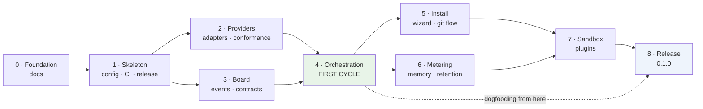

# Roadmap

From foundation documents to a first public release.

Acceptance criteria below are written as **observations, not intentions** — a command that
passes, a file that exists, a behaviour demonstrated. A product whose central claim is that
objective oracles beat opinions should hold its own roadmap to the same standard.

## Two changes to the proposed ordering

The starting suggestion put dogfooding and governance in the final phase. Both move
earlier, for reasons worth stating.

**Dogfooding moves from phase 8 to phase 4.** The earliest moment Corifeu can run one cycle
is the end of phase 4. Waiting four more phases to discover whether the architecture
survives contact with real work means discovering it after the installer, metering, memory
and the plugin protocol have all been built on top of it. The first self-hosted cycle is
phase 4's acceptance criterion, not a later milestone.

**Licence and governance files move from phase 8 to phase 1.** `NOTICE`, DCO enforcement
and `CONTRIBUTING.md` cost an afternoon and must exist before the first outside contribution
arrives, which is not a date anyone controls. A contribution accepted without DCO is
awkward to repair later.

Two things are also **added** that the suggestion did not list: the provider conformance
suite ([ADR-0039](adr/0039-provider-conformance-suite.md)) in phase 2, and file ownership
plus command confinement ([ADR-0035](adr/0035-file-ownership-by-glob-classes.md),
[ADR-0037](adr/0037-sandboxed-command-execution.md)) in phase 4 — before any doer is
allowed to write a file or run a command.

## Dependency graph

Phases 2 and 3 are independent and may run in parallel. Phases 5 and 6 likewise.

---

## Phase 0 — Foundation documents

**Scope.** Understand the prototype, record every decision, design the target.

**Deliverables.** `diagnosis.md`, `architecture.md`, 43 ADRs, `config.md`, `roadmap.md`,
`risks.md`, `open-questions.md`, `troubleshooting.md`, `glossary.md`. Legacy inconsistencies
cleaned; README marked as under rebuild.

**Acceptance.**
- Every file in the repository has a keep / rewrite / delete call.
- Every decision in the brief has an ADR with alternatives and consequences.
- All internal documentation links resolve.
- All Mermaid diagrams parse; all YAML examples parse.

**Dependencies.** None. **Risks.** Over-specifying before code exists — mitigated by
marking unverified claims as such rather than resolving them by assumption.

*Status: this session.*

---

## Phase 1 — Skeleton, configuration, shippability

**Scope.** A binary that does almost nothing, shipped properly, on every platform. The
instinct behind the original phase 1 — never be far from a release — is right and is kept.

**Deliverables.**
- Cargo workspace; `corifeu --version`, `--help`.
- ~~YAML parser spike~~ — **done 2026-10-12**. `serde-saphyr`, decided on error-message
  quality ([ADR-0040](adr/0040-yaml-parser-selection.md)).
- Config loader: YAML, JSON Schema validation, four-level precedence,
  `corifeu config show --explain`.
- `corifeu doctor` — platform, versions, `.gitignore` correctness. Provider checks land in
  phase 2.
- CI matrix: Linux, macOS, Windows × `x86_64`, `aarch64`. `cargo-deny` with `serde_yml` and
  `yaml-rust` denied.
- Release pipeline: tagged builds, **SHA-256 checksums, signed artefacts**.
- `install.sh` and `install.ps1` — download, verify, place the binary. No wizard yet.
- `NOTICE` (AGPL §7(b)), DCO check in CI, `CONTRIBUTING.md`, `CODE_OF_CONDUCT.md`.
- **Reserve `corifeu` on crates.io** — verified free on 2026-10-11, along with npm.

**Acceptance.**
- `corifeu --version` runs on all six matrix targets in CI.
- A malformed config produces an error naming **file, line and column**.
- `config show --explain` reports the source of every effective value across all four levels.
- A tagged release publishes signed, checksummed artefacts that `install.sh` and
  `install.ps1` both verify before placing.
- A PR without `Signed-off-by` fails CI.

**Dependencies.** Phase 0. **Risks.** YAML ecosystem instability
([ADR-0040](adr/0040-yaml-parser-selection.md)); Windows signing requires a certificate and
has lead time — start it in this phase.

---

## Phase 2 — Provider adapters

**Scope.** Talk to every supported model runtime, and prove the restrictions hold.

**Deliverables.**
- `Provider` trait with capability reporting.
- Adapters: Claude Code, Codex CLI, Gemini CLI, Ollama, llama.cpp.
- Local agent loop: tool definition, native and text-mode call parsing, nudge counting,
  identical-action loop detection — the behaviours `code.py` earned.
- **Conformance suite**, eight tests, including the adversarial restriction test.
- Real tool-call test, invokable from `doctor`.
- Ambient-context suppression per provider.

**Acceptance.**
- All five adapters pass tests 1–4 and 7–8 of the suite.
- **Test 5 passes for Claude Code, Codex and Antigravity**: an agent told it may not write,
  and then instructed to write, does not write. Antigravity already passes as of 2026-10-12.
- **Context isolation is measured for Antigravity**, which exposes no `--bare` equivalent.
  Either a mechanism is found, or the limitation is recorded and the provider is documented
  as unable to guarantee a clean context contract.
- A model that fails the tool-call test is refused for a tool-using role, with a message
  naming the probable cause (for llama.cpp, a missing `--jinja`).
- Scheduled CI job runs the suite against latest CLI versions.

**Dependencies.** Phase 1. The third provider is now **Antigravity CLI**, verified by
execution on 2026-10-12 — Gemini CLI was retired for individual users
([ADR-0044](adr/0044-antigravity-replaces-gemini-cli.md)). All three agent CLIs now have
measured capabilities, so no adapter is blocked on an environment.

**Risks.** Antigravity is **closed source**, so its behaviour can only be observed, never
read — which raises the conformance suite from useful to necessary. Its context-isolation
mechanism is still unverified. CI needs real credentials for cloud CLIs; see
[risks.md](risks.md).

---

## Phase 3 — Blackboard, events, contracts

**Scope.** State that survives, replays and resumes. Runs in parallel with phase 2.

**Deliverables.**
- SQLite with bundled compilation, WAL, schema migrations.
- Append-only event log; deterministic projections.
- Content-addressed artefact store with deduplication.
- Message types and published JSON Schemas.
- View assembler and context contracts, **with explicit truncation**.
- `corifeu run --resume`.

**Acceptance.**
- Projecting the same event log twice yields byte-identical state.
- A run killed with `SIGKILL` mid-task resumes without repeating completed work.
- The same file referenced twenty times occupies one blob.
- A contract limited to `max_tokens` produces a view within budget, and any truncation is
  **marked in the payload** with the retained range and full size — regression-tested,
  because this is the prototype's most dangerous bug.
- A message violating its schema is rejected, not stored.

**Dependencies.** Phase 1. **Risks.** Projection determinism is easy to break and expensive
to debug; property-test it from the start.

---

## Phase 4 — Orchestration, ownership, first cycle

**Scope.** Make it actually work, end to end, once. **This is the phase that decides whether
the architecture is right.**

**Deliverables.**
- Role categories, user-defined roles, presets, configuration validation.
- Lead loop: delegate, collect, summarise, escalate.
- Contracted channels; round limits, budgets, loop detection, timeouts.
- **File classes and ownership** ([ADR-0035](adr/0035-file-ownership-by-glob-classes.md)),
  with `corifeu explain-path`.
- **Command confinement, first stage**: allowlist plus argv-only execution, no `sh -c`.
  Platform sandboxing lands in phase 7.
- Oracle execution and tie-breaking.
- `corifeu run`.

**Acceptance.**
- A real feature is delivered end to end in a scratch repository: plan → code → oracles →
  review → fix → commit.
- The lead's cumulative context stays bounded as task count grows — **measured and
  reported**, not asserted.
- A doer writing outside its owned classes is denied; an unclassified path is denied.
- `explain-path <file>` names the class, the matching rule, and the owning roles.
- A sibling test file (`src/x/y_test.ts`) classifies as `test`, not `source`.
- A forced disagreement with a failing test resolves in the oracle's favour.
- A deliberately looping pair stops at three rounds and escalates.
- **Corifeu completes one cycle on its own repository.** Dogfooding begins.

**Dependencies.** Phases 2 and 3. **Risks.** The highest-risk phase. Local models may prove
too weak for useful doer work — the mitigation is that role-to-model assignment is
configuration, so the answer is reassignment, not redesign. Budget defaults taken from the
prototype's experience rather than measurement will need revising here.

---

## Phase 5 — Installation experience

**Scope.** Make it adoptable by someone who has not read the source.

**Deliverables.**
- Interactive wizard: detection, lead, granularity, roles, file classes, oracles, autonomy,
  git flow, visibility.
- Marker-based merging for `CLAUDE.md`, `AGENTS.md`, `GEMINI.md`, `.gitignore`; additive
  key merging with a managed-key record for JSON.
- Git flow: every step configurable, conservative defaults.
- Autonomy levels.
- `corifeu update`, `corifeu uninstall`, `--purge`.
- Non-interactive install from a config file.

**Acceptance.**
- A fresh repository on each of the four platforms reaches a working configuration through
  the wizard alone.
- `install` → `uninstall` leaves every foreign file **byte-identical** to its pre-install
  state, verified by hash.
- `uninstall` keeps `config.yaml`; reinstalling from it reproduces the configuration exactly.
- Hand-edited content inside markers causes a **stop and ask**, never an overwrite.
- The owner's git flow from [config.md](config.md) is expressible and behaves as described,
  including the push gate.
- `--non-interactive` with a complete config asks nothing.

**Dependencies.** Phase 4. **Risks.** Wizard length causing abandonment — mitigated by
presets pre-filling answers. Foreign-file merging is where damage to user repositories would
occur; the byte-identical criterion is the guard.

---

## Phase 6 — Metering, memory, retention

**Scope.** Prove the economic claim, and let the system learn about the project.

**Deliverables.**
- Per-role, per-model, per-task usage recording.
- Cost reporting: money for metered APIs, **quota percentage for subscriptions**,
  tokens plus wall-clock for local.
- Pricing data file, updatable without a new binary.
- Project memory: read through contracts, written by proposal.
- Retention and compaction, both limits.

**Acceptance.**
- A completed run reports actual spend and a **labelled estimate** of lead-only spend.
- A subscription-billed lead reports percentages, never fabricated currency.
- **Real run sizes are measured and [ADR-0022](adr/0022-run-retention-policy.md) is updated
  to cite measurements instead of estimates.**
- Compaction preserves summary, final artefacts, metering and escalations; the compacted
  state is visibly marked as compacted.
- Memory proposals appear as reviewable diffs under supervised autonomy.

**Dependencies.** Phase 4. **Risks.** Subscription quota may not be programmatically
readable from any CLI — currently UNVERIFIED. If it is not, the report degrades to a token
percentage and must say so rather than inventing a denominator.

---

## Phase 7 — Sandboxing and plugins

**Scope.** Make it safe to hand to strangers, and prove the extensibility claim.

**Deliverables.**
- Platform sandboxing: Seatbelt, Landlock/seccomp, restricted token/job object.
- Honest degradation where no sandbox exists.
- Plugin protocol: JSON-RPC over stdio, manifest, version negotiation, lifecycle.
- Five extension points wired; built-ins migrated onto the same interfaces.
- **An example plugin in a separate repository.**

**Acceptance.**
- A command attempting to write outside the workspace is blocked by the sandbox on each
  platform that has one.
- Where no sandbox is available, `doctor` **says so explicitly** and the allowlist plus
  argv-only path still holds.
- A plugin in a separate repository provides a working checker with **zero commits to this
  repository** — the only honest proof of the Open/Closed claim.
- A protocol-version mismatch is refused with a clear message.
- A crashing plugin fails its task without taking down the run or leaving a zombie.

**Dependencies.** Phases 5 and 6. **Risks.** Three sandbox implementations is the largest
single engineering item outside phase 4. Freezing the plugin protocol too early — mitigated
by shipping it marked **experimental** in 0.1.0, with the stability promise beginning at
0.2.0.

---

## Phase 8 — First public release

**Scope.** 0.1.0.

**Deliverables.**
- Documentation site: install, concepts, configuration reference, troubleshooting, plugin
  authoring.
- `README.md` reviewed against the shipped product (rewritten for the Corifeu identity on
  2026-10-12, ahead of this phase).
- Issue and PR templates; security policy.
- Versioning and compatibility policy, stating what 0.1.0 does and does not promise.
- Release 0.1.0 and announce.

**Acceptance.**
- A person who has never seen the project installs it and completes a task using only the
  published documentation.
- Every UNVERIFIED mark in the documentation is either resolved or explicitly declared a
  known limitation.
- The owner's daily work runs on Corifeu. (The legacy `.orchestra/` tree was removed on
  2026-10-12 — [ADR-0034](adr/0034-break-existing-personal-setup.md).)
- The compatibility policy states plainly that the plugin protocol is experimental.

**Dependencies.** Phase 7. **Risks.** `curl | sh` distribution invites scrutiny — checksums,
signatures and a readable install script are the answer ([risks.md](risks.md)).

---

## Explicitly deferred

| Deferred | To | Reason |
|---|---|---|
| Direct provider APIs | MVP 2 | Adapter interface already admits them without core changes |
| Parallel doers with git worktrees | post-0.1 | Needs merge and conflict machinery; board is pre-designed for it |
| Hardware-based model recommendations | post-0.1 | Honest advice needs data that is hard to obtain portably |
| Non-software domains | post-0.1 | Kept open by naming discipline, not by machinery |
| Git-host abstraction beyond `gh` | post-0.1 | Needs two implementations before the interface can be designed honestly |
| Plugin registry | indefinite | A product in itself |
| Custom domain | if the project succeeds | GitHub Releases suffices |
| WASM plugins | post-0.1 | Revisit alongside sandboxing; addresses both problems |
| Localised CLI output | on demand | No evidence of need yet |

## Sequencing principle

Every phase from 4 onward ends with Corifeu having built part of itself. That is the only
honest test available, and it is cheap: the project is its own first user, with the same
motivation as every other user to notice what is broken.
